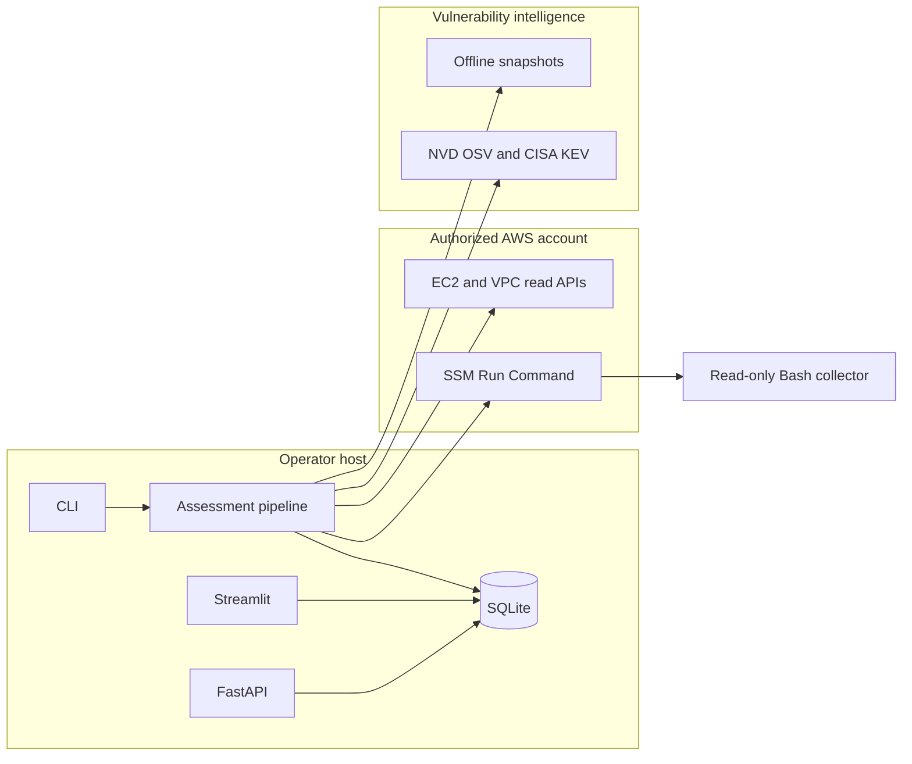

# Architecture

CloudRecon is one Python application with a SQLite database, a FastAPI process, and a Streamlit dashboard. Ansible and the Bash collector run on authorized Linux instances. They are not separate services.

Demo mode never enters the AWS or live-intel paths. It uses `examples/intel` and the synthetic fleet in `cloudrecon/demo`.

## Pipeline

1. Discover assets, or load the synthetic fleet.
2. Persist the asset even when host collection is missing.
3. Assess exposure from security groups, routes, public addresses, and load balancers.
4. Parse host inventory. A failed parse does not become an empty package list with a successful status.
5. Match packages to vendor or OSV ranges, then NVD, then optional Trivy and Inspector input.
6. Enrich with the loaded CISA KEV snapshot.
7. Rank open matches with the rules in `config/risk_rules.yaml`.
8. Deduplicate by asset, CVE, package, and installed version. Evidence from additional sources is merged.
9. Resolve an existing open finding only when a later scan collected packages successfully and that version is gone.

## Match precedence

An exact ecosystem comparison from a vendor advisory or OSV is authoritative. If that comparison says the installed revision is fixed, the finding is not affected even when the upstream version sits inside an NVD range. NVD alone produces `potentially_affected`. Trivy or Inspector can confirm a package only when the same name and version were collected from the host.

Disagreement is kept in the evidence list. It is not discarded to force a single source.

## Version comparison

Debian epoch, upstream, and revision ordering is used for deb packages, including tilde. RPM epoch, version, and release ordering is used for Amazon Linux. PEP 440 is used for application components such as Maven artifacts. Comparison failure yields `unknown`, which is not stored as an open finding.

## Exposure

`internet_potential` is true only when a world-open rule (`0.0.0.0/0` or `::/0`) coincides with a public IP or an internet-facing load balancer, and a collected route table does not positively show the absence of an internet gateway for the instance path. `verified_reachable` is set only from an authorized probe. Missing security group data stays unknown.

## Lifecycle

Remediation states are open, under investigation, remediation in progress, resolved, accepted risk, and false positive. The API can set every state except resolved. Resolved is written when a successful rescan no longer observes the vulnerable version. Accepted risk and false positive are left in place. A resolved finding that is observed again is reopened.

## Processes

The API binds to localhost in the CLI. Docker Compose publishes it on `127.0.0.1` only. The dashboard reads the same SQLite file. There is no message bus and no Kubernetes requirement.
